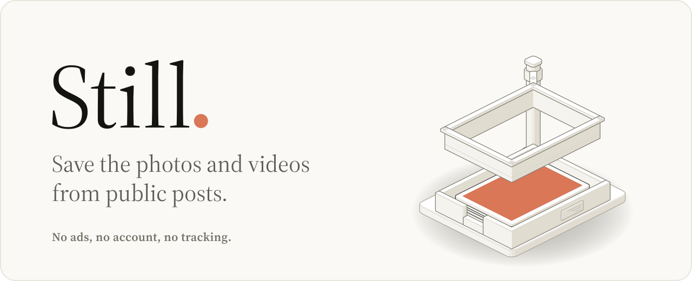
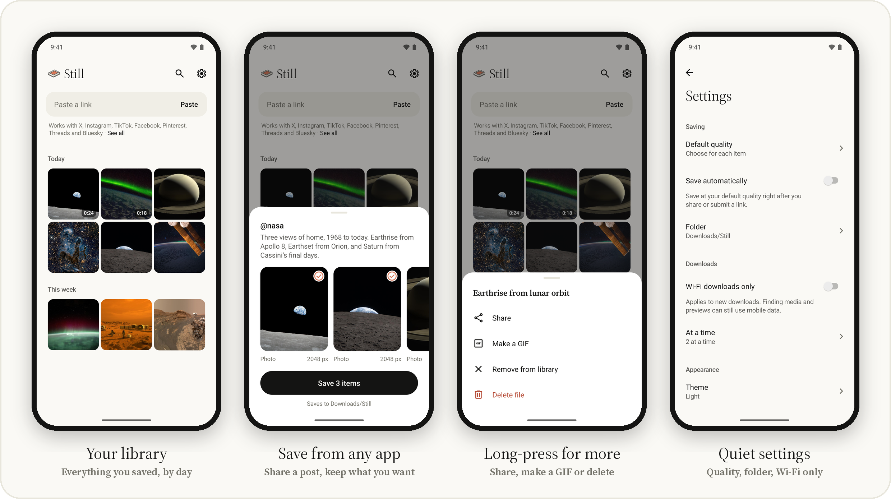

<picture>
  <source media="(prefers-color-scheme: dark)" srcset="docs/readme/hero-dark.svg">
  
</picture>

<p>
  <a href="https://github.com/zefan-xu/still/releases/latest">
    <picture>
      <source media="(prefers-color-scheme: dark)" srcset="docs/readme/download-dark.svg">
      
    </picture>
  </a>
</p>

<picture>
  <source media="(prefers-color-scheme: dark)" srcset="docs/readme/platforms-dark.svg">
  
</picture>

<br><br>

Still is a small Android app for keeping the photos, videos and GIFs from public posts. Share a link to it from any app, choose what to keep, and carry on; the files land in your Downloads folder and in a quiet library you can browse, share and turn into GIFs. It has no advertising, analytics, purchases or sign-in, and it never asks for an account.

<picture>
  <source media="(prefers-color-scheme: dark)" srcset="docs/readme/screens-dark.png">
  
</picture>

## How it works

1. **Share a post to Still.** A sheet opens over the app you were in, with a preview of every photo, video and GIF in the post. You can also paste a link on Still's home screen.
2. **Keep what you want.** Everything is selected; tap a preview to leave it out, or pick a quality per item. Tap **Save** and go back to what you were doing. Downloads continue in the background.
3. **Find it later.** Home is your library, grouped by day, with search. Tap to view full screen; long-press to share, make a GIF, open the original post, remove it from the library or delete the file.

Files go to `Downloads/Still`, or to another folder inside Downloads. Settings cover default quality (highest, smallest or choose each time), saving automatically on share, Wi-Fi-only downloads, one to four downloads at a time, and light, dark or system appearance.

## Where it works

| Platform | What saves |
| --- | --- |
| X | Videos, GIFs and photos |
| Instagram | Photos, carousels and videos |
| TikTok | Videos and photo slideshows |
| Facebook | Videos and reels |
| Pinterest | Videos and image pins |
| Threads | Photos, carousels and videos |
| Bluesky | Videos and photos |
| YouTube | Videos and Shorts, up to 4K |

Only public posts work. Private, login-only and deleted posts, streaming-only video such as live streams, and Facebook photos are not supported. YouTube serves most qualities as separate video and audio files; on Android 10 or later, Still downloads both and combines them on your phone without re-encoding. Qualities YouTube offers as H.264, usually up to 1080p, save as MP4. Above that, Still uses AV1 saved as MP4 on Android 14 or later, or VP9 saved as WebM. Qualities your phone can't play are not shown, so many phones top out at 1080p or 1440p. On Android 7 to 9, only YouTube's complete files, usually 360p, are offered. Platforms change without notice, so a scheduled job downloads real posts from every platform each week and opens an issue when one stops working; [VALIDATION.md](VALIDATION.md) lists the exact posts. If a link that used to work stops, [tell us](https://github.com/zefan-xu/still/issues/new?template=link-stopped-working.yml).

## Privacy

Still reads posts the way a logged-out browser would, directly from your phone. There is no Still server.

- **No tracking.** No advertising SDK, advertising ID, analytics or crash reporting.
- **No accounts.** Still never asks you to sign in and never imports browser cookies or credentials. When a platform requires one for a public file, it uses an anonymous session cookie and checks its scope on every redirect.
- **Only what's needed leaves your phone.** For X, only the post ID goes to the open-source [FxTwitter](https://github.com/FxEmbed/FxEmbed) API; you can point Settings at your own instance. Other platforms are contacted directly, and the bundled [yt-dlp](https://github.com/yt-dlp/yt-dlp) extractor runs on the device. It updates only when you ask, from yt-dlp's official GitHub release.
- **Clipboard on request.** Still reads the clipboard only when you tap **Paste**.

## Install

Download **Still-x.y.z.apk** from the [latest release](https://github.com/zefan-xu/still/releases/latest) on an Android 7.0 or newer phone, open it, and allow your browser or file manager to install apps when Android asks. Each release installs over the last one and keeps your library. If you installed a build you made yourself, or one from before the first release, uninstall it once first; it is signed with a different key.

### Get updates with Obtainium

[Obtainium](https://github.com/ImranR98/Obtainium) installs apps from their GitHub releases and checks for new ones. On your phone, [add Still to Obtainium](https://apps.obtainium.imranr.dev/redirect?r=obtainium://add/https://github.com/zefan-xu/still), or add `https://github.com/zefan-xu/still` in Obtainium by hand. Each release then shows up as an update.

Obtainium installs the same signed APK as the release page. After the first install, you can check it with [AppVerifier](https://github.com/soupslurpr/AppVerifier): the package is `org.still.saver` and the signing certificate SHA-256 is `14:0B:DC:20:9B:58:30:C1:9C:C9:19:9D:94:FA:05:EE:93:85:3D:47:0B:8E:1A:04:FC:96:D0:A1:1E:2A:8B:B0`. Android refuses any later update signed with a different key.

<details>
<summary>Verify a download</summary>

<br>

Each release lists the APK's SHA-256 and ships a `SHA256SUMS.txt`. Every release is signed with the same key, whose certificate SHA-256 is:

```
14:0B:DC:20:9B:58:30:C1:9C:C9:19:9D:94:FA:05:EE:93:85:3D:47:0B:8E:1A:04:FC:96:D0:A1:1E:2A:8B:B0
```

```sh
shasum -a 256 -c SHA256SUMS.txt
apksigner verify --print-certs Still-x.y.z.apk   # "Signer #1 certificate SHA-256 digest" must match
```

The release workflow refuses to publish an APK signed by any other certificate ([`release/signing-certificate.sha256`](release/signing-certificate.sha256)).

</details>

## How Still is tested

Every change reaches `main` through a pull request that must pass one required check, **CI passed**. Behind it:

- **Unit and property tests.** 134 JVM tests run the real link parsers, resolvers, library model and GIF encoder. [jqwik](https://jqwik.net) property tests feed them thousands of generated links, MP4 boxes and library states per run.
- **Mutation testing.** [PIT](https://pitest.org) plants small bugs in the core code; the build fails if fewer than 73% are caught. Line and branch coverage must stay above their floors as well.
- **Static analysis.** [Error Prone](https://errorprone.info) and Android lint run with warnings as errors.
- **Real devices.** 31 workflows (saving, the library, sharing, playback and the viewer, GIF export, merging video and audio, which qualities the phone can play, settings and download state) run on Android 10 and Android 15 emulators against real files.
- **Release checks.** Before each release, the exact signed APK is checked for its version, signing certificate and bundled licenses, then installed and launched on an Android 15 emulator.

[TESTING.md](TESTING.md) covers what each layer proves, what it doesn't, and how to run it.

## Releases

A new version ships automatically every Monday at 15:00 UTC when app code on `main` has changed since the last release. The release job reruns the full CI suite on that exact commit, builds and signs the APK, verifies and smoke-tests it, then tags `vX.Y.Z` and publishes notes grouped by pull request label. Versions come from the tag: weekly releases bump the patch, and raising `baseVersion` in [`app/build.gradle`](app/build.gradle) starts a minor or major release. A maintainer can also run the **Release** workflow by hand. [docs/distribution.md](docs/distribution.md) covers the F-Droid and IzzyOnDroid listing in `fastlane/` and whether builds are reproducible.

<details>
<summary>Maintainers: signing secrets</summary>

<br>

The release job needs four repository secrets: `RELEASE_KEYSTORE_BASE64` (the PKCS#12 keystore, base64-encoded), `RELEASE_KEYSTORE_PASSWORD`, `RELEASE_KEY_ALIAS` and `RELEASE_KEY_PASSWORD`. Keep an offline backup of the keystore: Android only installs updates signed with the same key, so losing it means every user must uninstall to upgrade. If the key ever changes, update `release/signing-certificate.sha256` in the same pull request.

</details>

## Build from source

You need JDK 17 or newer (CI uses 21), Python 3, and the Android SDK with platform 35 and build-tools 35.0.0. Set `ANDROID_HOME`, or put `sdk.dir=/path/to/sdk` in an ignored `local.properties`.

```sh
./gradlew :app:assembleDebug                 # app/build/outputs/apk/debug/app-debug.apk
python3 scripts/test.py local                # every check CI runs without a device
python3 scripts/test.py device --serial emulator-5554
```

Work on a branch, open a pull request, and it merges once **CI passed** is green. The README images come from `python3 scripts/test.py screenshots`, which renders the app with public-domain NASA imagery, and [`scripts/readme_art.py`](scripts/readme_art.py).

## License

Still is free software under the [GPL-3.0-or-later](LICENSE). Bundled components keep their own licenses, listed with their sources in [THIRD_PARTY_NOTICES.md](THIRD_PARTY_NOTICES.md); the typeface is [Source Serif 4](licenses/SourceSerif4-OFL-1.1.txt) under the SIL Open Font License. Images in the screenshots are courtesy of NASA ([credits](app/src/androidTest/assets/README.md#readme-screenshots)); NASA does not endorse Still. Still is not affiliated with any of the platforms it works with.
